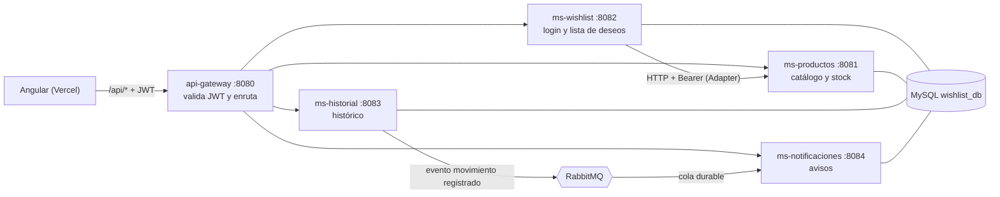
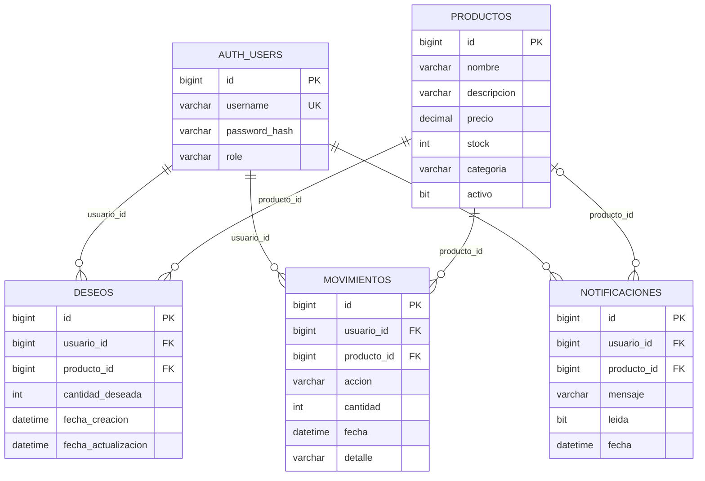

# Carvajal · Lista de deseos (Wishlist) — Backend

Backend de la **Lista de deseos** del e-commerce B2C de Carvajal, construido como **microservicios** con
Java 21 y Spring Boot 3.5. Un **API Gateway** es la única entrada pública: valida el **JWT** y reparte las
peticiones a cuatro servicios (catálogo, lista de deseos, historial y notificaciones).

- Frontend (Angular): <https://github.com/santiagohoyosm1-hash/carvajal-fronend>
- Backend en producción (gateway): <https://carvajal-backend-production.up.railway.app>
- Frontend en producción: `<URL-de-Vercel>`

---

## 1. Cumplimiento de la prueba técnica

| Requisito | Cómo se cumple |
|---|---|
| Ver el catálogo con existencias | `GET /api/productos` devuelve `stock` por producto; la pantalla **Catálogo** lo muestra («Agotado» si es 0). |
| Listar, agregar, eliminar y actualizar la lista de deseos | `/api/wishlist` (GET, POST, PATCH, DELETE). El back valida que el producto exista, esté activo y tenga stock. |
| Avisar si un deseo ya no tiene stock | Al consultar **Mi lista**, el frontend cruza cada deseo con el catálogo vigente y marca los productos con stock insuficiente, inactivos o retirados. Además, el back responde `409` si se intenta agregar o subir una cantidad mayor al stock. |
| Histórico de registros de la lista | `ms-historial` guarda cada movimiento (AGREGADO / ACTUALIZADO / ELIMINADO) en la tabla `movimientos`. |
| Usuario existente y autenticado | Login con **JWT**; el `usuarioId` viaja en el token. Las cuentas las crea un administrador. |
| Productos simulados | `ms-productos` carga 5 productos de ejemplo si la tabla está vacía. |
| Tipo de base de datos | **MySQL 8** (justificación en la sección 6). |
| Lógica de negocio por API-REST | Todos los servicios exponen REST/JSON. |
| Persistencia con ORM | Spring Data JPA + Hibernate. |
| Documento del modelo de datos | Sección 6 (diagrama entidad-relación + script SQL). |
| Pruebas unitarias y de integración | 43 pruebas automáticas (sección 14). |
| **Plus** JWT | Spring Security OAuth2 Resource Server, HS256, tokens de 15 minutos. |
| **Plus** Microservicios | API Gateway + 4 microservicios + mensajería con RabbitMQ. |
| **Plus** Docker | `Dockerfile` multietapa por servicio y `docker-compose.yml` con MySQL y RabbitMQ. |
| **Plus** GitFlow | Ramas `main`, `develop`, `feature/*`, `release/*` y tags (sección 17). |

---

## 2. Arquitectura



| Servicio | Puerto local | Responsabilidad |
|---|---|---|
| `api-gateway` | 8080 | Único punto de entrada: CORS, validación del JWT y enrutamiento por prefijo. |
| `ms-wishlist` | 8082 | Autenticación (emite JWT) y lista de deseos. Consulta el catálogo vía **Adapter**. |
| `ms-productos` | 8081 | Catálogo: CRUD con borrado lógico y 5 productos de ejemplo. |
| `ms-historial` | 8083 | Guarda los movimientos y publica un evento en RabbitMQ. |
| `ms-notificaciones` | 8084 | Consume el evento, guarda la notificación y permite marcarla como leída. |

**Decisiones de diseño**
- **Comunicación síncrona (HTTP):** `ms-wishlist` → `ms-productos` para validar existencia y stock en el momento de agregar.
- **Comunicación asíncrona (RabbitMQ):** `ms-historial` → `ms-notificaciones`, para que registrar un movimiento no dependa de que el servicio de avisos esté disponible.
- **Defensa en profundidad:** el gateway valida el JWT y cada microservicio lo valida de nuevo.
- Cada servicio es *stateless*, así que puede escalar horizontalmente.

---

## 3. Tecnologías

Java 21 · Spring Boot 3.5.7 · Spring Cloud Gateway (WebFlux, 2025.0.0) · Spring Data JPA / Hibernate ·
Spring Security (JWT, HS256) · Bean Validation · Lombok · MySQL 8.4 · RabbitMQ 4 · Maven · Docker ·
Pruebas: JUnit 5, Mockito, MockMvc, `MockRestServiceServer` y H2 en memoria.

---

## 4. Estructura del repositorio

```
carvajal-backend/
├── api-gateway/          Spring Cloud Gateway (JWT + rutas)
├── ms-wishlist/          auth (JWT) + lista de deseos + adaptador del catálogo
├── ms-productos/         catálogo
├── ms-historial/         histórico + publicación de eventos
├── ms-notificaciones/    consumo de eventos + avisos
├── database/             scripts SQL (esquema y consultas de revisión)
├── docker-compose.yml    MySQL y RabbitMQ para desarrollo local
├── .env.example          variables de entorno de referencia
└── README.md
```

Cada servicio tiene su propio `pom.xml`, `Dockerfile` y capas `controller → service → repository`,
más `dto`, `entity` y `exception` (manejo global de errores).

---

## 5. Despliegue local (paso a paso)

### 5.1 Requisitos
- **JDK 21** y **Maven 3.9+** (o solo Docker, ver 14.2 para ejecutar las pruebas).
- **Docker Desktop** abierto (motor en ejecución).
- **Node.js** 22.22.3+, 24.15+ o 26+ para el frontend.
- Git. Opcional: **MySQL Workbench**.

### 5.2 Infraestructura (MySQL y RabbitMQ)
```bash
git clone https://github.com/santiagohoyosm1-hash/carvajal-backend.git
cd carvajal-backend
docker compose up -d
docker logs carvajal-mysql --tail 3      # debe decir «ready for connections»
```

### 5.3 Variables de entorno
`JWT_SECRET` debe ser **la misma en los cinco servicios** (gateway incluido). `AUTH_ADMIN_USERNAME` y
`AUTH_ADMIN_PASSWORD` solo las usa `ms-wishlist`, que **no arranca si faltan** (crea el administrador inicial).

**Linux / macOS**
```bash
export JWT_SECRET=$(openssl rand -base64 32)
export AUTH_ADMIN_USERNAME=admin
export AUTH_ADMIN_PASSWORD='Admin-Carvajal-2026'
```

**Windows (PowerShell)** — se guardan para tu usuario; abre terminales nuevas después:
```powershell
$rng = [Security.Cryptography.RandomNumberGenerator]::Create()
$bytes = New-Object byte[] 32
$rng.GetBytes($bytes); $rng.Dispose()
[Environment]::SetEnvironmentVariable("JWT_SECRET", [Convert]::ToBase64String($bytes), "User")
[Environment]::SetEnvironmentVariable("AUTH_ADMIN_USERNAME", "admin", "User")
[Environment]::SetEnvironmentVariable("AUTH_ADMIN_PASSWORD", "Admin-Carvajal-2026", "User")
```

### 5.4 Iniciar los servicios
Una terminal por servicio, desde la raíz del repositorio:
```bash
cd ms-productos       && mvn spring-boot:run     # 8081
cd ms-wishlist        && mvn spring-boot:run     # 8082
cd ms-historial       && mvn spring-boot:run     # 8083
cd ms-notificaciones  && mvn spring-boot:run     # 8084
cd api-gateway        && mvn spring-boot:run     # 8080  ← el frontend usa solo este
```
Hibernate crea las tablas la primera vez (`DDL_AUTO=update`) y `ms-productos` inserta los 5 productos de ejemplo.

### 5.5 Prueba rápida
```bash
# 1. Login
curl -s -X POST http://localhost:8080/api/auth/login \
  -H "Content-Type: application/json" \
  -d '{"username":"admin","password":"Admin-Carvajal-2026"}'

# 2. Con el accessToken de la respuesta
TOKEN=<accessToken>
curl -s http://localhost:8080/api/productos -H "Authorization: Bearer $TOKEN"

# 3. Crear un cliente de prueba (solo ADMIN)
curl -s -X POST http://localhost:8080/api/auth/users \
  -H "Authorization: Bearer $TOKEN" -H "Content-Type: application/json" \
  -d '{"username":"cliente1","password":"Cliente-Prueba-2026"}'
```
En PowerShell usa `curl.exe` (no `curl`) o `Invoke-RestMethod`.

### 5.6 Frontend
```bash
git clone https://github.com/santiagohoyosm1-hash/carvajal-fronend.git
cd carvajal-fronend/frontend
npm install
npm start          # http://localhost:4200 (el proxy envía /api al gateway en localhost:8080)
```
Entra con `cliente1` / `Cliente-Prueba-2026`, o con el administrador.

---

## 6. Base de datos

### 6.1 Motor elegido: MySQL 8
- Los datos son **relacionales y transaccionales** (usuarios, productos, deseos): MySQL ofrece integridad, restricciones únicas y `DECIMAL` exacto para precios.
- Encaja con **Spring Data JPA/Hibernate** y es de uso muy extendido.
- Se administra con **MySQL Workbench** y Railway lo ofrece como servicio gestionado.
- RabbitMQ transporta los eventos; la **persistencia** de histórico y notificaciones sigue en MySQL.

### 6.2 Modelo entidad-relación
Los servicios comparten una instancia MySQL (esquema `wishlist_db`) por simplicidad de despliegue, pero **cada tabla
pertenece a un solo servicio**. Entre servicios no hay claves foráneas físicas: las referencias (`usuario_id`,
`producto_id`) son **lógicas** y se validan en la aplicación, para no acoplar los microservicios por la base de datos.



| Tabla | Servicio | Reglas |
|---|---|---|
| `auth_users` | ms-wishlist | `username` único (minúsculas); contraseña con BCrypt; `role` = `ADMIN` o `USER`. |
| `productos` | ms-productos | `precio` DECIMAL(12,2); `stock` ≥ 0; `activo` = borrado lógico. |
| `deseos` | ms-wishlist | Único `(usuario_id, producto_id)`: un producto por usuario; `cantidad_deseada` ≥ 1. |
| `movimientos` | ms-historial | Solo se insertan; índice por `usuario_id`. |
| `notificaciones` | ms-notificaciones | `leida` por defecto `0`; índice por `usuario_id`. |

### 6.3 Script de creación (MySQL 8)
Es **opcional**: con la configuración por defecto (`DDL_AUTO=update`) Hibernate crea las tablas al arrancar. Úsalo para
crear o revisar el esquema a mano en Workbench. Se ejecuta solo cuando el volumen de MySQL está vacío si lo montas en
`docker-entrypoint-initdb.d` (así lo hace `docker-compose.yml` con `database/01_wishlist_db.sql`).

```sql
CREATE DATABASE IF NOT EXISTS wishlist_db
  CHARACTER SET utf8mb4 COLLATE utf8mb4_0900_ai_ci;

USE wishlist_db;

-- Usuario de aplicación (solo si MySQL NO lo crea por ti; con docker compose ya existe)
CREATE USER IF NOT EXISTS 'carvajal'@'%' IDENTIFIED BY 'carvajal123';
GRANT ALL PRIVILEGES ON wishlist_db.* TO 'carvajal'@'%';
FLUSH PRIVILEGES;

-- ms-wishlist · cuentas de acceso (la clave se guarda con BCrypt, nunca en claro)
CREATE TABLE IF NOT EXISTS auth_users (
  id             BIGINT       NOT NULL AUTO_INCREMENT,
  username       VARCHAR(50)  NOT NULL,
  password_hash  VARCHAR(100) NOT NULL,
  role           VARCHAR(10)  NOT NULL,            -- 'ADMIN' | 'USER'
  PRIMARY KEY (id),
  CONSTRAINT uk_auth_users_username UNIQUE (username)
) ENGINE=InnoDB;

-- ms-productos · catálogo
CREATE TABLE IF NOT EXISTS productos (
  id           BIGINT        NOT NULL AUTO_INCREMENT,
  nombre       VARCHAR(120)  NOT NULL,
  descripcion  VARCHAR(500)  NULL,
  precio       DECIMAL(12,2) NOT NULL,
  stock        INT           NOT NULL DEFAULT 0,
  categoria    VARCHAR(80)   NULL,
  activo       BIT(1)        NOT NULL DEFAULT b'1', -- borrado lógico
  PRIMARY KEY (id),
  CONSTRAINT ck_productos_stock CHECK (stock >= 0)
) ENGINE=InnoDB;

-- ms-wishlist · lista de deseos (un producto por usuario)
CREATE TABLE IF NOT EXISTS deseos (
  id                   BIGINT      NOT NULL AUTO_INCREMENT,
  usuario_id           BIGINT      NOT NULL,
  producto_id          BIGINT      NOT NULL,
  cantidad_deseada     INT         NOT NULL DEFAULT 1,
  fecha_creacion       DATETIME(6) NOT NULL DEFAULT CURRENT_TIMESTAMP(6),
  fecha_actualizacion  DATETIME(6) NOT NULL DEFAULT CURRENT_TIMESTAMP(6),
  PRIMARY KEY (id),
  CONSTRAINT uk_deseos_usuario_producto UNIQUE (usuario_id, producto_id),
  CONSTRAINT ck_deseos_cantidad CHECK (cantidad_deseada >= 1)
) ENGINE=InnoDB;

-- ms-historial · histórico de movimientos de la lista (solo se inserta, no se modifica)
CREATE TABLE IF NOT EXISTS movimientos (
  id           BIGINT       NOT NULL AUTO_INCREMENT,
  usuario_id   BIGINT       NOT NULL,
  producto_id  BIGINT       NOT NULL,
  accion       VARCHAR(30)  NOT NULL,              -- AGREGADO | ACTUALIZADO | ELIMINADO
  cantidad     INT          NULL,
  fecha        DATETIME(6)  NOT NULL DEFAULT CURRENT_TIMESTAMP(6),
  detalle      VARCHAR(500) NULL,
  PRIMARY KEY (id),
  INDEX ix_movimientos_usuario (usuario_id)
) ENGINE=InnoDB;

-- ms-notificaciones · avisos al usuario
CREATE TABLE IF NOT EXISTS notificaciones (
  id           BIGINT       NOT NULL AUTO_INCREMENT,
  usuario_id   BIGINT       NOT NULL,
  producto_id  BIGINT       NULL,
  mensaje      VARCHAR(500) NOT NULL,
  leida        BIT(1)       NOT NULL DEFAULT b'0',
  fecha        DATETIME(6)  NOT NULL DEFAULT CURRENT_TIMESTAMP(6),
  PRIMARY KEY (id),
  INDEX ix_notificaciones_usuario (usuario_id)
) ENGINE=InnoDB;
```
Si creas las tablas con este script y arrancas con `DDL_AUTO=update`, Hibernate puede añadir un índice único equivalente con
otro nombre. Es inofensivo.

**Datos de ejemplo.** No hace falta insertarlos: `ms-productos` carga solos estos 5 productos cuando la tabla está vacía
(se desactiva con `SEED_PRODUCTOS=false`).

| Producto | Precio (COP) | Stock | Categoría |
|---|---|---|---|
| Teclado mecanico | 189.900 | 25 | Perifericos |
| Mouse inalambrico | 69.900 | 40 | Perifericos |
| Monitor 24 pulgadas | 649.900 | 12 | Pantallas |
| Auriculares con microfono | 259.900 | 18 | Audio |
| Webcam HD | 119.900 | 30 | Video |

### 6.4 Configuración y revisión con MySQL Workbench
1. Nueva conexión: host `127.0.0.1`, puerto `3306`, usuario `carvajal`, clave `carvajal123`.
2. Abre la base `wishlist_db` y revisa las tablas. En Railway la base se llama `railway` y se conecta con el proxy TCP público
   del servicio MySQL (host y puerto del proxy, usuario `root`); elimina ese proxy al terminar.
3. Consultas de revisión: `database/02_consultas_revision.sql`. Por ejemplo:
```sql
SELECT * FROM movimientos ORDER BY id DESC;                       -- histórico
SELECT * FROM notificaciones WHERE leida = 0;                     -- avisos pendientes
SELECT d.usuario_id, p.nombre, d.cantidad_deseada, p.stock        -- deseos con stock insuficiente
  FROM deseos d JOIN productos p ON p.id = d.producto_id
 WHERE d.cantidad_deseada > p.stock OR p.activo = 0;
```

---

## 7. Credenciales

> Valores de **demostración para ejecución local**. En un entorno real se definen como variables de entorno y se cambian.

| Recurso | Usuario | Contraseña |
|---|---|---|
| MySQL administrador (docker compose) | `root` | `root123` |
| MySQL de la aplicación | `carvajal` | `carvajal123` |
| RabbitMQ y consola `http://localhost:15672` | `carvajal` | `carvajal123` |
| Administrador de la app (rol `ADMIN`) | `admin` (`AUTH_ADMIN_USERNAME`) | `Admin-Carvajal-2026` (`AUTH_ADMIN_PASSWORD`) |
| Cliente de prueba (rol `USER`) | `cliente1` | `Cliente-Prueba-2026` (se crea con `POST /api/auth/users`) |

Reglas de las cuentas: usuario de 3 a 50 caracteres (`A-Z a-z 0-9 . _ -`) y contraseña de **12 a 72 caracteres**.

---

## 8. Variables de entorno

| Variable | Servicios | Por defecto | Descripción |
|---|---|---|---|
| `PORT` | todos | 8080 / 8081 / 8082 / 8083 / 8084 | Puerto HTTP (Railway lo inyecta). |
| `JWT_SECRET` | **todos** | — (obligatoria) | Clave HS256 en Base64 de 32 bytes o más; igual en todos los servicios. |
| `DB_URL` | 4 microservicios | `jdbc:mysql://localhost:3306/wishlist_db?...` | URL JDBC de MySQL. |
| `DB_USER`, `DB_PASSWORD` | 4 microservicios | `carvajal` / `carvajal123` | Credenciales de MySQL. |
| `DDL_AUTO` | 4 microservicios | `update` | Estrategia de Hibernate para el esquema. |
| `SHOW_SQL` | 4 microservicios | `false` | Muestra las sentencias SQL. |
| `CORS_ORIGINS` | todos | `http://localhost:4200` | Orígenes permitidos, separados por coma. |
| `AUTH_ADMIN_USERNAME`, `AUTH_ADMIN_PASSWORD` | ms-wishlist | — (obligatorias) | Administrador inicial. |
| `JWT_ACCESS_TOKEN_TTL` | ms-wishlist | `PT15M` | Vigencia del token (formato ISO-8601). |
| `PRODUCTOS_URL` | ms-wishlist, api-gateway | `http://localhost:8081` | Dirección de `ms-productos`. |
| `WISHLIST_URL`, `HISTORIAL_URL`, `NOTIFICACIONES_URL` | api-gateway | `http://localhost:8082` / `8083` / `8084` | Direcciones de los servicios. |
| `SEED_PRODUCTOS` | ms-productos | `true` | Carga los 5 productos de ejemplo. |
| `RABBITMQ_HOST`, `RABBITMQ_PORT`, `RABBITMQ_USER`, `RABBITMQ_PASSWORD` | ms-historial, ms-notificaciones | `localhost` / `5672` / `carvajal` / `carvajal123` | Conexión a RabbitMQ. |
| `RABBITMQ_LISTENER_AUTO_STARTUP` | ms-notificaciones | `true` | `false` desactiva el consumidor (útil sin RabbitMQ). |

---

## 9. API REST

Todas las rutas van por el gateway (`http://localhost:8080`). Errores con formato único:
`{ "status": 404, "error": "Not Found", "mensaje": "...", "fecha": "..." }`.

**Autenticación** (`ms-wishlist`)

| Método | Ruta | Acceso | Descripción |
|---|---|---|---|
| POST | `/api/auth/login` | Público | `{ "username", "password" }` → `accessToken`, `tokenType`, `expiresIn`, `usuarioId`, `role`. 401 si son incorrectos. |
| POST | `/api/auth/users` | ADMIN | Crea una cuenta con rol `USER`. 201, 400, 403, 409. |

**Lista de deseos** (`ms-wishlist`)

| Método | Ruta | Descripción | Respuestas |
|---|---|---|---|
| GET | `/api/wishlist/{usuarioId}` | Lista los deseos del usuario. | 200 |
| POST | `/api/wishlist` | `{ "usuarioId", "productoId", "cantidadDeseada" }`. Si ya existe, actualiza la cantidad (por defecto 1). | 201, 400, 404, 409, 503 |
| PATCH | `/api/wishlist/{id}?cantidad=n` | Cambia la cantidad. Bajarla no consulta el catálogo; subirla valida el stock. | 200, 400, 404, 409, 503 |
| DELETE | `/api/wishlist/{id}` | Elimina el deseo. | 204, 404 |

**Catálogo** (`ms-productos`)

| Método | Ruta | Descripción |
|---|---|---|
| GET | `/api/productos` | Solo productos **activos**. |
| GET | `/api/productos/{id}` | Detalle (404 si no existe). |
| POST / PUT | `/api/productos`, `/api/productos/{id}` | Crea / actualiza. Valida nombre, precio ≥ 0 y stock ≥ 0. |
| DELETE | `/api/productos/{id}` | Borrado lógico (`activo = false`). |

**Historial** (`ms-historial`)

| Método | Ruta | Descripción |
|---|---|---|
| GET | `/api/historial/{usuarioId}` | Movimientos del más reciente al más antiguo. |
| POST | `/api/historial` | `{ "usuarioId", "productoId", "accion", "cantidad", "detalle" }`. Guarda y publica el evento. |

**Notificaciones** (`ms-notificaciones`)

| Método | Ruta | Descripción |
|---|---|---|
| GET | `/api/notificaciones/{usuarioId}` | Avisos del usuario. |
| POST | `/api/notificaciones` | Crea un aviso manual. |
| PATCH | `/api/notificaciones/{id}/leida` | Marca como leída. |

**Reglas de negocio de la lista** (`DeseoService`): el producto debe existir y estar activo; `cantidadDeseada` no puede
superar el stock (409); un producto por usuario (restricción única más `POST` idempotente); si `ms-productos` no responde en
2 s (conexión) o 3 s (lectura), la API contesta **503** con un mensaje claro y las lecturas de la lista siguen funcionando.
Agregar a la lista **no descuenta stock**: una lista de deseos no es una compra.

---

## 10. Seguridad (JWT)

- `ms-wishlist` emite el token (HS256, emisor `carvajal-auth`) con el `usuarioId` en `sub` y el rol en el claim `role`. Vigencia: **15 minutos**, sin *refresh token*.
- El **gateway** deja público solo `POST /api/auth/login`; exige rol `ADMIN` para `POST /api/auth/users`; todo lo demás requiere token válido.
- Cada microservicio **vuelve a validar** el token con la misma clave (`JWT_SECRET`). El adaptador del catálogo reenvía el token del usuario a `ms-productos`.
- Las contraseñas se guardan con **BCrypt**; no hay registro público.
- El frontend guarda el token en `sessionStorage`, lo envía con un interceptor y cierra la sesión al vencer o ante un `401`.

---

## 11. Mensajería (RabbitMQ)

| Elemento | Valor |
|---|---|
| Exchange | `carvajal.events` (direct, durable) |
| Cola | `notificaciones.movimiento.registrado` (durable) |
| Routing key | `historial.movimiento.registrado` |
| Mensaje (JSON) | `MovimientoRegistradoEvent { usuarioId, productoId, mensaje }` |

Flujo: `POST /api/historial` → se guarda el movimiento → se publica el evento (mensaje persistente) → `ms-notificaciones` lo
consume y crea la notificación. Si RabbitMQ no está disponible al publicar, **el movimiento se guarda igual** y se registra una
advertencia; mientras el consumidor esté caído, la cola durable conserva los eventos.

---

## 12. Patrones de diseño aplicados

Basados en la *Guía de Patrones de Diseño con Spring Boot*:

| Patrón (sección de la guía) | Dónde está | Para qué |
|---|---|---|
| **Adapter** (4.1) | `ms-wishlist/.../catalogo/` | `DeseoService` depende de la interfaz `CatalogoProductos`; `ProductosHttpAdapter` traduce la API de `ms-productos` a `ProductoCatalogo`. Cambiar de proveedor no toca la lógica, y las pruebas usan un falso de una línea. |
| **Singleton** (3.1) | `ProductosProperties` (`@ConfigurationProperties`), beans de Spring | Una sola instancia compartida y sin estado por usuario. |
| **Builder** (3.3) | `DeseoResponse` (`@Builder`), `ResponseEntity.created(...)` | Construcción legible de respuestas. |
| **Capas / controlador delgado** (cf. 4.3) | Todos los servicios | El controlador recibe y responde; la lógica vive en el `@Service`. |
| **Publicación/suscripción** (equivalente distribuido de Observer, 5.2) | `ms-historial` → RabbitMQ → `ms-notificaciones` | Reaccionar a un hecho sin acoplar a quien reacciona. |

Principios SOLID: **D** (dependencia de interfaces, `CatalogoProductos`), **O** (nuevo adaptador sin modificar el servicio),
**S** (cada microservicio y cada clase con una sola responsabilidad). Siguiendo la advertencia de la guía contra la
«patronitis», no se forzaron Factory, Strategy ni Decorator porque el problema no los pide.

---

## 13. Docker

- Cada servicio tiene un `Dockerfile` **multietapa** (Maven + JDK 21 para compilar, JRE 21 para ejecutar). Son los que usa Railway.
- `docker-compose.yml` levanta la infraestructura local: MySQL 8.4 (con volumen y el script de `database/`) y RabbitMQ 4 con consola.

Ejecutar un servicio en contenedor (ejemplo `ms-productos`):
```bash
docker build -t ms-productos ./ms-productos
docker run --rm -p 8081:8081 \
  -e JWT_SECRET="$JWT_SECRET" \
  -e DB_URL="jdbc:mysql://host.docker.internal:3306/wishlist_db?useSSL=false&allowPublicKeyRetrieval=true&serverTimezone=UTC" \
  -e DB_USER=carvajal -e DB_PASSWORD=carvajal123 \
  ms-productos
```

---

## 14. Pruebas

### 14.1 Cobertura (43 pruebas)

| Módulo | Pruebas | Tipo |
|---|---|---|
| `ms-wishlist` · `DeseoServiceTest` | 11 | Unitarias (Mockito, catálogo falso): stock, producto inactivo o inexistente, actualizar y eliminar. |
| `ms-wishlist` · `ProductosHttpAdapterTest` | 5 | Unitarias del Adapter con `MockRestServiceServer`: traducción, stock nulo, producto ausente, catálogo caído y propagación del JWT. |
| `ms-wishlist` · `DeseoControllerTest` | 7 | Capa web (`@WebMvcTest`): JWT obligatorio, validaciones 400, 404 y 409. |
| `ms-wishlist` · `AuthControllerTest` | 2 | Integración: emisión de JWT y rol ADMIN para crear usuarios. |
| `ms-productos` · `ProductoControllerTest` | 4 | Integración (`@SpringBootTest` + H2): CRUD, validación y CORS. |
| `ms-historial` · `HistorialControllerTest` | 3 | Integración: registro, listado y evento publicado. |
| `ms-notificaciones` · `NotificacionControllerTest` | 5 | Integración: alta, lectura, marcar leída y consumo del evento. |
| `api-gateway` · `ApiGatewayIntegrationTest` | 6 | Integración: login público, rutas protegidas, reenvío del Bearer, CORS y restricción por rol. |

### 14.2 Ejecutarlas
```bash
cd ms-wishlist && mvn test        # repetir en cada servicio
```
Sin Maven instalado (solo Docker), desde la carpeta del servicio:
```bash
docker run --rm -v "${PWD}:/app" -v m2cache:/root/.m2 -w /app maven:3.9-eclipse-temurin-21 mvn test
```
Las pruebas de integración usan H2 en memoria y no necesitan MySQL ni RabbitMQ.

---

## 15. Despliegue en la nube (Railway + Vercel)

**Railway** — un proyecto con **MySQL**, **RabbitMQ** (plantilla de Railway) y un servicio por carpeta
(*New → GitHub Repo → este repositorio*; en *Settings → Root Directory* pon la carpeta del servicio; Railway usa su `Dockerfile`).
Expón públicamente **solo el gateway**; los demás se comunican por la red privada `*.railway.internal`.

Variables de los cuatro microservicios:
```
DB_URL=jdbc:mysql://${{MySQL.MYSQLHOST}}:${{MySQL.MYSQLPORT}}/${{MySQL.MYSQLDATABASE}}?useSSL=false&allowPublicKeyRetrieval=true&serverTimezone=UTC
DB_USER=${{MySQL.MYSQLUSER}}
DB_PASSWORD=${{MySQL.MYSQLPASSWORD}}
JWT_SECRET=<la-misma-clave-base64-en-todos-los-servicios>
```

| Servicio | Root Directory | Variables adicionales |
|---|---|---|
| ms-productos | `ms-productos` | `PORT=8081` |
| ms-wishlist | `ms-wishlist` | `PORT=8082`, `AUTH_ADMIN_USERNAME`, `AUTH_ADMIN_PASSWORD`, `PRODUCTOS_URL=http://ms-productos.railway.internal:8081` |
| ms-historial | `ms-historial` | `PORT=8083`, `RABBITMQ_HOST`, `RABBITMQ_PORT`, `RABBITMQ_USER`, `RABBITMQ_PASSWORD` |
| ms-notificaciones | `ms-notificaciones` | `PORT=8084`, mismas variables `RABBITMQ_*` |
| api-gateway | `api-gateway` | `JWT_SECRET`, `CORS_ORIGINS=https://<tu-frontend>.vercel.app`, `WISHLIST_URL=http://ms-wishlist.railway.internal:8082`, `PRODUCTOS_URL=http://ms-productos.railway.internal:8081`, `HISTORIAL_URL=http://ms-historial.railway.internal:8083`, `NOTIFICACIONES_URL=http://ms-notificaciones.railway.internal:8084` |

En el gateway genera el dominio público (*Settings → Networking → Generate Domain*) y comprueba que
`https://<dominio>/api/productos` responde `401` sin token. Revisa los *Deploy Logs* si un servicio no arranca: las causas
más comunes son `JWT_SECRET` ausente o distinto, `AUTH_ADMIN_*` vacíos y una `DB_URL` mal armada.

**Vercel (frontend)** — *Root Directory* `frontend`, *Output Directory* `dist/frontend/browser`. `vercel.json` reenvía `/api/*` al
dominio público del **gateway**:
```json
{
  "rewrites": [
    { "source": "/api/(.*)", "destination": "https://<dominio-del-gateway>/api/$1" },
    { "source": "/((?!api/).*)", "destination": "/index.html" }
  ]
}
```

---

## 16. Solución de problemas

| Síntoma | Causa probable |
|---|---|
| `ms-wishlist` no arranca: «Configura AUTH_ADMIN_USERNAME y AUTH_ADMIN_PASSWORD» | Faltan las variables del administrador. |
| «JWT_SECRET debe ser una clave codificada en Base64» | La clave no es Base64 o mide menos de 32 bytes. |
| Todas las llamadas dan `401` | `JWT_SECRET` distinto entre servicios, o el token venció (15 min). |
| `Communications link failure` | MySQL no está arriba, o `DB_URL` apunta a `localhost` dentro de un contenedor (usa `host.docker.internal`). |
| `503` al agregar un deseo | `ms-productos` caído o `PRODUCTOS_URL` incorrecta. |
| No llegan notificaciones | RabbitMQ caído o `RABBITMQ_*` incorrectas; revisa la consola `http://localhost:15672`. |
| `failed to connect to the docker API` | Docker Desktop no está abierto. |

---

## 17. Estrategia de ramas (GitFlow)

| Rama | Uso |
|---|---|
| `main` | Código en producción; cada versión lleva un tag (`v1.0.0`). |
| `develop` | Integración continua del trabajo terminado. |
| `feature/*` | Cada cambio nuevo, desde `develop`. |
| `release/*` | Preparación de una versión; se fusiona en `main` y `develop`. |

```bash
git switch -c feature/nombre develop
git add . && git commit -m "feat: descripción"
git switch develop && git merge --no-ff feature/nombre

git switch -c release/1.0.0 develop
git switch main && git merge --no-ff release/1.0.0 && git tag -a v1.0.0 -m "Release 1.0.0"
git switch develop && git merge --no-ff release/1.0.0
git push origin main develop --tags
```
Ver el historial: `git log --oneline --graph --all`.

---

## 18. Limitaciones conocidas y mejoras previstas

- **El token autentica, pero no restringe el `usuarioId`:** un usuario con sesión podría consultar o modificar datos de otro cambiando el id. Mejora: usar el `sub` del JWT como identidad (y reservar el acceso cruzado al rol `ADMIN`).
- **Escritura del catálogo:** `POST/PUT/DELETE /api/productos` no exige rol `ADMIN`. Mejora: `hasRole("ADMIN")` en la configuración de seguridad de `ms-productos`.
- **Histórico enviado por el frontend:** `ms-wishlist` no registra los movimientos por sí mismo. Mejora: que publique el evento tras confirmar la transacción (`@TransactionalEventListener`) o use un *outbox*.
- **Aviso de stock:** hoy se calcula al consultar la lista en pantalla. Mejora: generar además una notificación persistente cuando un deseo quede sin stock.
- **El adaptador consulta todo el catálogo activo** para buscar un producto. Mejora: `GET /api/productos/{id}` con 404 limpio.
- **Base de datos compartida** por simplicidad. Producción: una base por servicio.
- **JWT con clave simétrica compartida y sin *refresh token***. Producción: clave asimétrica (RS256/JWKS) o un proveedor como Keycloak, más renovación de tokens.